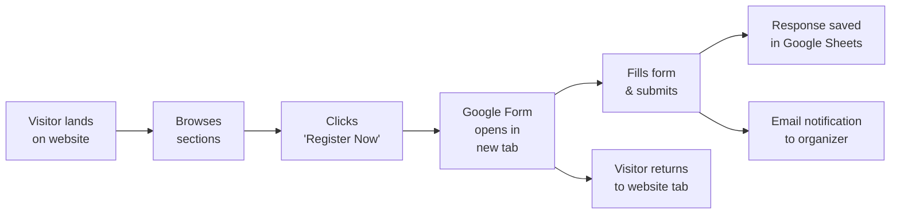
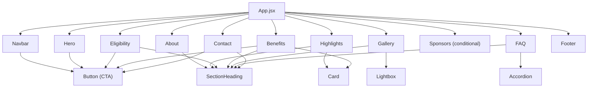

# Miss Satyabhama Fashion Show — Project Plan

> **Document Version:** 1.0  
> **Created:** 2026-10-24  
> **Status:** Awaiting Owner Approval  
> **Phase:** 1 — Planning & Requirements

---

## Table of Contents

1. [Project Overview](#1-project-overview)
2. [Project Goals](#2-project-goals)
3. [Target Audiences](#3-target-audiences)
4. [Confirmed Requirements](#4-confirmed-requirements)
5. [Unconfirmed Information & Questions](#5-unconfirmed-information--questions)
6. [Website Section Order & Purpose](#6-website-section-order--purpose)
7. [Design Direction](#7-design-direction)
8. [Technology Stack & Justification](#8-technology-stack--justification)
9. [Photography & Asset Requirements](#9-photography--asset-requirements)
10. [Registration User Journey](#10-registration-user-journey)
11. [Accessibility & Performance Considerations](#11-accessibility--performance-considerations)
12. [Responsive-Design Requirements](#12-responsive-design-requirements)
13. [Proposed Project Architecture](#13-proposed-project-architecture)
14. [Development Phases & Acceptance Criteria](#14-development-phases--acceptance-criteria)
15. [Risks, Assumptions & Dependencies](#15-risks-assumptions--dependencies)
16. [Owner Checklist — Information & Assets Required](#16-owner-checklist--information--assets-required)

---

## 1. Project Overview

**Miss Satyabhama** is a fashion show event held in **Vijayawada, Andhra Pradesh, India**. This project delivers a premium, single-page marketing website that:

- Presents the event with a luxury fashion-editorial aesthetic.
- Showcases professional photography from previous or promotional shoots.
- Communicates eligibility criteria, participation process, and benefits.
- Drives visitor-to-registrant conversion via an embedded Google Form link.
- Establishes brand credibility for the Miss Satyabhama property.

The website is a **static frontend application** — no custom backend, database, or authentication system is required. Registration is handled entirely through Google Forms with responses stored in Google Sheets.

---

## 2. Project Goals

| # | Goal | Success Metric |
|---|------|---------------|
| G1 | **Premium brand presence** — the website should feel like a high-end fashion event, not a generic template. | Subjective design review by owner; consistent luxury-editorial visual language across all sections. |
| G2 | **Clear information delivery** — visitors understand what Miss Satyabhama is, who can participate, and how to register within 60 seconds of landing. | Key information reachable within 2 scrolls; registration CTA visible at all times via sticky nav or floating button. |
| G3 | **High registration conversion** — every page section funnels toward the "Register Now" action. | Prominent CTA placement in hero, eligibility, benefits, and sticky navigation. |
| G4 | **Visual storytelling through photography** — professional fashion photography is the centrepiece of the experience. | Full-bleed hero imagery, curated gallery, and inline editorial-style photography throughout sections. |
| G5 | **Mobile-first responsiveness** — the majority of the target audience will access the site on mobile devices. | Fully functional and visually polished on viewports from 320px to 2560px. |
| G6 | **Fast loading performance** — images and animations must not compromise page speed. | Lighthouse performance score ≥ 85 on mobile. |
| G7 | **Easy deployment and maintenance** — the site must deploy to Vercel or Netlify with zero backend configuration. | One-command build; static output; environment-variable–driven configuration. |

---

## 3. Target Audiences

### Primary Audiences

| Audience | Profile | Intent |
|----------|---------|--------|
| **Aspiring models & participants** | Ages 18–35 (estimated), fashion-interested, social-media–active, predominantly mobile users. | Learn about the event, assess eligibility, register. |
| **Talent scouts & agencies** | Industry professionals evaluating the event's credibility. | Review the event's calibre, past editions, and production quality. |

### Secondary Audiences

| Audience | Profile | Intent |
|----------|---------|--------|
| **Potential sponsors & partners** | Brand managers, local businesses. | Evaluate sponsorship or partnership opportunities. |
| **Fashion enthusiasts & media** | Bloggers, journalists, influencer community. | Discover the event, share content. |
| **Parents & family** | Guardians of younger participants. | Verify event legitimacy and safety. |

---

## 4. Confirmed Requirements

The following are established and will not change:

| # | Requirement | Details |
|---|-------------|---------|
| C1 | Event name | **Miss Satyabhama** |
| C2 | Event location (city) | **Vijayawada, Andhra Pradesh, India** |
| C3 | Website type | Single-page marketing website (scrollable sections) |
| C4 | Registration method | Google Forms (externally hosted) |
| C5 | Response storage | Google Sheets (linked to the Google Form) |
| C6 | Frontend framework | React + Vite + JavaScript |
| C7 | Styling | Tailwind CSS |
| C8 | Animations | Motion for React (formerly Framer Motion) |
| C9 | Icons | Lucide React |
| C10 | Deployment target | Vercel or Netlify |
| C11 | Custom domain | To be connected post-deployment |
| C12 | Backend | None required |
| C13 | Database | None required |
| C14 | Authentication | None required |
| C15 | Photography source | Owner-provided (from Miss Satyabhama events) |
| C16 | Design aesthetic | Luxury fashion-editorial; black/white with champagne-gold accents |

---

## 5. Unconfirmed Information & Questions

> [!IMPORTANT]
> The following items **must be provided by the owner** before the corresponding development phase can begin. Items marked 🔴 are blockers for their phase; items marked 🟡 are deferrable but should be resolved before Phase 11 (testing & optimization).

### Event Details

| # | Item | Status | Blocking Phase |
|---|------|--------|---------------|
| U1 | 🔴 Event date(s) and time(s) | TO BE PROVIDED | Phase 5 |
| U2 | 🔴 Event venue name and address | TO BE PROVIDED | Phase 5 |
| U3 | 🔴 Event edition/year (e.g., "Season 3", "2027") | TO BE PROVIDED | Phase 4 |
| U4 | 🟡 Event tagline or slogan | TO BE PROVIDED | Phase 4 |

### Eligibility & Participation

| # | Item | Status | Blocking Phase |
|---|------|--------|---------------|
| U5 | 🔴 Age requirements / categories | TO BE PROVIDED | Phase 6 |
| U6 | 🔴 Height requirements (if any) | TO BE PROVIDED | Phase 6 |
| U7 | 🔴 Gender eligibility | TO BE PROVIDED | Phase 6 |
| U8 | 🔴 Nationality / residency requirements | TO BE PROVIDED | Phase 6 |
| U9 | 🔴 Experience-level requirements (open to freshers?) | TO BE PROVIDED | Phase 6 |
| U10 | 🔴 Registration fee (if any) and payment method | TO BE PROVIDED | Phase 6 |
| U11 | 🔴 Registration deadline | TO BE PROVIDED | Phase 6 |

### Selection Process

| # | Item | Status | Blocking Phase |
|---|------|--------|---------------|
| U12 | 🔴 Selection stages (screening → audition → finale?) | TO BE PROVIDED | Phase 6 |
| U13 | 🟡 Judging criteria | TO BE PROVIDED | Phase 6 |

### Benefits & Prizes

| # | Item | Status | Blocking Phase |
|---|------|--------|---------------|
| U14 | 🔴 Prizes for winners (title, cash, modelling contract, etc.) | TO BE PROVIDED | Phase 7 |
| U15 | 🔴 Training or grooming provided to participants | TO BE PROVIDED | Phase 7 |
| U16 | 🟡 Media exposure / portfolio benefits | TO BE PROVIDED | Phase 7 |
| U17 | 🟡 Networking or career-placement opportunities | TO BE PROVIDED | Phase 7 |

### Registration & Integration

| # | Item | Status | Blocking Phase |
|---|------|--------|---------------|
| U18 | 🔴 Google Form URL | TO BE PROVIDED | Phase 9 |
| U19 | 🟡 Google Form email-notification configuration confirmed | TO BE PROVIDED | Phase 9 |

### Branding & Assets

| # | Item | Status | Blocking Phase |
|---|------|--------|---------------|
| U20 | 🔴 Miss Satyabhama logo (SVG preferred, PNG fallback) | TO BE PROVIDED | Phase 3 |
| U21 | 🔴 Hero photograph(s) — minimum 1, recommended 3 | TO BE PROVIDED | Phase 4 |
| U22 | 🔴 Gallery photographs — recommended 12–20 images | TO BE PROVIDED | Phase 8 |
| U23 | 🟡 Sponsor / partner logos (if applicable) | TO BE PROVIDED | Phase 10 |
| U24 | 🟡 Favicon / browser-tab icon | TO BE PROVIDED | Phase 3 |

### Contact & Social

| # | Item | Status | Blocking Phase |
|---|------|--------|---------------|
| U25 | 🔴 Official email address | TO BE PROVIDED | Phase 10 |
| U26 | 🔴 Official phone / WhatsApp number | TO BE PROVIDED | Phase 10 |
| U27 | 🟡 Instagram handle / URL | TO BE PROVIDED | Phase 10 |
| U28 | 🟡 Facebook page URL | TO BE PROVIDED | Phase 10 |
| U29 | 🟡 YouTube channel URL (if any) | TO BE PROVIDED | Phase 10 |
| U30 | 🟡 Other social-media links | TO BE PROVIDED | Phase 10 |

### Organizational

| # | Item | Status | Blocking Phase |
|---|------|--------|---------------|
| U31 | 🟡 Organizer / organization name | TO BE PROVIDED | Phase 5 |
| U32 | 🟡 Brief organizer bio or credentials | TO BE PROVIDED | Phase 5 |
| U33 | 🟡 "About" narrative for Miss Satyabhama (mission, vision, history) | TO BE PROVIDED | Phase 5 |
| U34 | 🟡 FAQ list (or confirmation to draft generic FAQs for review) | TO BE PROVIDED | Phase 10 |
| U35 | 🟡 Custom domain name | TO BE PROVIDED | Phase 12 |

### Design Decisions

| # | Question | Blocking Phase |
|---|----------|---------------|
| Q1 | Should the site be a single scrollable page with section anchors, or use React Router for multiple pages? **Recommendation: Single page with smooth-scroll anchors.** | Phase 2 |
| Q2 | Should the hero section use a single static image, a slideshow/carousel, or a video background? **Recommendation: Image carousel (3–5 slides) with Motion transitions.** | Phase 4 |
| Q3 | Should the gallery open images in a lightbox modal, or simply display a masonry/grid layout? **Recommendation: Grid layout with lightbox on click.** | Phase 8 |
| Q4 | Should there be a countdown timer to the event/registration deadline? **Recommendation: Yes, if event date is confirmed.** | Phase 4 |
| Q5 | Is a sponsors/partners section needed for this edition? | Phase 10 |
| Q6 | Does the registration CTA open the Google Form in a new tab or in an embedded iframe? **Recommendation: New tab (avoids iframe security/styling issues).** | Phase 9 |

---

## 6. Website Section Order & Purpose

After analyzing the reference website structure and the needs of a fashion-event promotional site, the following section architecture is recommended:

### Recommended Section Order

```
┌─────────────────────────────────────────────────┐
│  1. NAVIGATION BAR (sticky)                     │
│     Logo · Section links · Register Now CTA     │
├─────────────────────────────────────────────────┤
│  2. HERO SECTION                                │
│     Full-screen cinematic imagery               │
│     Event name, tagline, date/location          │
│     Primary "Register Now" button               │
│     Optional countdown timer                    │
├─────────────────────────────────────────────────┤
│  3. ABOUT MISS SATYABHAMA                       │
│     Event mission, vision, and story            │
│     What makes it unique in Vijayawada / AP     │
│     Credibility statement                       │
├─────────────────────────────────────────────────┤
│  4. EVENT HIGHLIGHTS                            │
│     Key facts: runway, grooming, media, prizes  │
│     Visual cards or icon-driven highlights      │
├─────────────────────────────────────────────────┤
│  5. ELIGIBILITY & SELECTION PROCESS             │
│     (Combined: criteria + step-by-step process) │
│     Who can participate                         │
│     How selection works (Register → Screen →    │
│     Audition → Finale)                          │
│     Inline "Register Now" CTA                   │
├─────────────────────────────────────────────────┤
│  6. BENEFITS & OPPORTUNITIES                    │
│     Training, exposure, prizes, networking      │
│     Structured as value-proposition cards        │
│     Inline "Register Now" CTA                   │
├─────────────────────────────────────────────────┤
│  7. GALLERY                                     │
│     Curated photo grid from past events         │
│     Lightbox viewer on click                    │
│     Categories/filters if >15 images            │
├─────────────────────────────────────────────────┤
│  8. FREQUENTLY ASKED QUESTIONS                  │
│     Accordion-style expandable Q&A              │
├─────────────────────────────────────────────────┤
│  9. SPONSORS & PARTNERS (conditional)           │
│     Logo grid — include only if sponsors exist  │
├─────────────────────────────────────────────────┤
│ 10. CONTACT & SOCIAL                            │
│     Email, phone/WhatsApp, social links         │
│     Final "Register Now" CTA                    │
├─────────────────────────────────────────────────┤
│ 11. FOOTER                                      │
│     Copyright · Quick links · Legal             │
└─────────────────────────────────────────────────┘
```

### Section Decisions & Rationale

| Original Proposal | Recommendation | Rationale |
|--------------------|---------------|-----------|
| 3. About Miss Satyabhama + 4. About the fashion show | **Combine into one "About" section** | Separating event identity from event format creates redundancy. A single, compelling "About" section with two subsections (the brand story + this edition's format) is more cohesive and avoids losing the visitor's attention early. |
| 5. Event highlights | **Retain as standalone section** | Serves as a scannable "at a glance" bridge between the About narrative and the detail-heavy eligibility section. Use icon-driven cards for quick comprehension. |
| 6. Eligibility + 7. Registration/Selection | **Combine into one section** | These are logically sequential — "Who can participate?" immediately followed by "How does the process work?" Separating them forces the visitor to scroll through two distinct sections for one question. |
| 8. Benefits | **Retain as standalone** | Strong conversion driver. Positioning it right after eligibility/process answers "Why should I register?" at the exact moment the visitor is deciding. |
| 9. Gallery | **Retain as standalone** | Visual proof of the event's calibre. Placed after benefits to provide social proof that reinforces the value proposition. |
| 10. Sponsors | **Conditional — include only if sponsors exist** | An empty or fabricated sponsors section damages credibility. Show only if logos are provided. |
| 11. FAQ | **Retain** | Addresses remaining objections before the final CTA. Position near the bottom so visitors who've scrolled this far (high intent) get their last questions answered. |
| 12. Contact + 13. Footer | **Keep as two distinct elements** | Contact is a content section with social links and a final CTA. Footer is a structural element with copyright, quick links, and legal text. |

### CTA Distribution Strategy

"Register Now" buttons should appear in these locations for maximum conversion:

1. **Navigation bar** — always visible (sticky).
2. **Hero section** — primary above-the-fold CTA.
3. **End of Eligibility & Selection** — after the visitor confirms they qualify.
4. **End of Benefits** — after the visitor is motivated.
5. **Contact section** — final CTA before the footer.

All buttons link to the same configurable Google Form URL.

---

## 7. Design Direction

### Colour Palette

| Role | Colour | Value | Usage |
|------|--------|-------|-------|
| Primary Background | Rich Black | `#0A0A0A` | Page background, hero overlays |
| Secondary Background | Off-Black | `#141414` | Alternate section backgrounds |
| Primary Text | Pure White | `#FFFFFF` | Headings, hero text |
| Secondary Text | Warm Grey | `#B3B3B3` | Body text, descriptions |
| Accent | Champagne Gold | `#C9A96E` | CTAs, dividers, highlights, hover states |
| Accent Hover | Light Gold | `#D4BC8A` | Button hover, link hover |
| Surface | Dark Charcoal | `#1A1A1A` | Cards, elevated surfaces |
| Border | Subtle Grey | `#2A2A2A` | Dividers, card borders |

### Typography

| Element | Font Family | Weight | Size Range (Desktop) |
|---------|------------|--------|---------------------|
| Display / Hero | Playfair Display (serif) | 700 | 48–72px |
| Section Headings | Playfair Display (serif) | 600 | 32–40px |
| Subheadings | Inter or Montserrat (sans-serif) | 600 | 18–24px |
| Body Text | Inter or Montserrat (sans-serif) | 400 | 16–18px |
| Captions / Labels | Inter or Montserrat (sans-serif) | 500 | 12–14px |
| CTA Buttons | Inter or Montserrat (sans-serif) | 600 | 14–16px, uppercase, letter-spacing: 0.1em |

> [!NOTE]
> Final font pairing to be confirmed during Phase 3 (Design System). Google Fonts will be used for performance and licensing simplicity.

### Animation Philosophy

- **Restrained and purposeful** — animations guide attention, they don't distract.
- **Scroll-triggered reveals** — sections fade in and slide up as they enter the viewport.
- **Subtle hover states** — buttons, cards, and gallery items respond to interaction.
- **Hero transitions** — smooth crossfade between hero images (if carousel).
- **No parallax scrolling** — avoided for performance and accessibility.
- **Reduced motion** — respect `prefers-reduced-motion` media query; disable all animations for users who prefer reduced motion.
- **Duration range** — 300–600ms for most transitions; easing: `ease-out` or custom spring.

### Visual Elements

- **Full-bleed imagery** — hero and gallery images extend to viewport edges.
- **Overlay gradients** — dark-to-transparent gradients over hero images for text legibility.
- **Gold accent lines** — thin horizontal rules (`1px`, champagne gold) to divide sections.
- **Card elevation** — subtle borders or `box-shadow` on dark backgrounds; no heavy drop shadows.
- **Image treatment** — slight desaturation filter on gallery images, full colour on hover (editorial effect).

---

## 8. Technology Stack & Justification

| Technology | Version | Purpose | Justification |
|-----------|---------|---------|---------------|
| **React** | 18.x+ | UI framework | Component-based architecture, rich ecosystem, strong community. |
| **Vite** | 5.x+ | Build tool & dev server | Fastest HMR, optimized production builds, native ES module support. |
| **JavaScript** (ES2022+) | — | Language | Meets project needs without the overhead of TypeScript setup for a single-page marketing site. |
| **Tailwind CSS** | 3.x+ | Utility-first styling | Rapid prototyping, design-system consistency, minimal CSS bundle via purging, excellent responsive utilities. |
| **Motion for React** | 11.x+ | Animations | Declarative animation API, scroll-triggered animations, spring physics, `useInView` hook for reveal effects. |
| **Lucide React** | Latest | Icons | Lightweight, tree-shakeable, consistent stroke-based icon set. Covers all needed icons (menu, close, social, arrows, chevrons). |
| **Google Fonts** | — | Typography | Free, performant, wide font selection. Loaded via `<link>` with `display=swap`. |

### Explicitly Excluded

| Technology | Reason for Exclusion |
|-----------|---------------------|
| TypeScript | Adds setup complexity for a small marketing site; can be introduced later if needed. |
| Backend (Node, Express, etc.) | No server-side logic required; registration handled by Google Forms. |
| Database (Firebase, Supabase, etc.) | Responses stored in Google Sheets via Forms integration. |
| Authentication | No user accounts needed. |
| CMS (Contentful, Sanity, etc.) | Content is static and owner-managed via code updates. |
| React Router | Single-page design with anchor navigation; no multi-page routing needed. |
| State management (Redux, Zustand) | No complex state; React's built-in `useState` / `useContext` suffices. |

### Build & Deployment

```
Development:     npm run dev    →  Vite dev server (localhost:5173)
Production:      npm run build  →  Static output in /dist
Preview:         npm run preview → Local preview of production build
Deployment:      Vercel or Netlify auto-deploy from Git repository
```

---

## 9. Photography & Asset Requirements

### Image Categories

| Category | Purpose | Qty Needed | Aspect Ratio | Min Resolution |
|----------|---------|-----------|--------------|----------------|
| **Hero images** | Full-screen background in hero carousel | 3–5 | 16:9 landscape | 1920 × 1080px |
| **About section** | Editorial inline image(s) beside text | 1–2 | 3:4 portrait or 1:1 | 800 × 1000px |
| **Gallery** | Past-event showcase | 12–20 | Mixed (portrait & landscape) | 1200px on longest edge |
| **Logo** | Navigation, hero, footer, favicon | 1 | Custom (SVG preferred) | Vector / 512px PNG |
| **Sponsor logos** | Sponsor grid (if applicable) | Variable | 3:2 or 1:1 | 400 × 200px |
| **OG / social share image** | Meta tags for social media previews | 1 | 1200 × 630px | Exact |

### Image Processing Pipeline

All owner-provided images will be processed during development:

1. **Format conversion** — Convert to WebP (primary) with JPEG fallback using `<picture>` elements.
2. **Responsive sizes** — Generate multiple widths (640, 960, 1280, 1920px) for `srcset`.
3. **Compression** — Target 80–85% quality for WebP; visually lossless.
4. **Lazy loading** — All images below the fold use `loading="lazy"` and `decoding="async"`.
5. **Hero preloading** — First hero image preloaded in `<head>` for fast LCP.
6. **Aspect-ratio hints** — `width` and `height` attributes set to prevent layout shift (CLS).
7. **Alt text** — Descriptive alt text for every image; decorative images use `alt=""`.
8. **Consistent treatment** — Slight desaturation CSS filter applied globally to gallery; removed on hover.

### Image File Organization

```
public/
└── images/
    ├── hero/
    │   ├── hero-1.webp
    │   ├── hero-2.webp
    │   └── hero-3.webp
    ├── about/
    │   └── about-editorial.webp
    ├── gallery/
    │   ├── gallery-01.webp
    │   ├── gallery-02.webp
    │   └── ...
    ├── sponsors/
    │   └── ...
    └── logo/
        ├── logo.svg
        ├── logo-white.svg
        └── favicon.ico
```

### Placeholder Strategy (During Development)

Until owner-provided photographs are available:

- Use solid-colour placeholder `<div>` elements with correct aspect ratios.
- Display "Image Placeholder — [Category]" text centered in the placeholder.
- **Do not** use stock photography, AI-generated images, or images from the reference site.
- Placeholders will be styled to match the dark theme (dark grey on black).

---

## 10. Registration User Journey

### Flow Diagram



### Technical Implementation Plan

1. **Centralized URL configuration:**
   ```
   // src/config/index.js
   export const REGISTRATION_URL = import.meta.env.VITE_REGISTRATION_URL
     || 'https://forms.google.com/PLACEHOLDER';
   ```
   - The Google Form URL is stored as an environment variable (`VITE_REGISTRATION_URL`).
   - A fallback placeholder URL is used during development.
   - All "Register Now" buttons import from this single source.

2. **Button behaviour:**
   - `<a href={REGISTRATION_URL} target="_blank" rel="noopener noreferrer">`
   - Opens in a new tab so the visitor doesn't lose their place on the website.
   - `rel="noopener noreferrer"` for security.

3. **Email notifications:**
   - Configured within Google Forms settings (not in website code).
   - Owner enables "Get email notifications for new responses" in Forms settings.
   - Optionally, a Google Apps Script can send formatted email confirmations to registrants.

4. **Registration status display (future enhancement):**
   - If registration is closed, the CTA can be toggled to display "Registration Closed" via another environment variable (`VITE_REGISTRATION_OPEN=true|false`).

---

## 11. Accessibility & Performance Considerations

### Accessibility (WCAG 2.1 AA Target)

| Area | Requirement |
|------|------------|
| **Colour contrast** | All text meets 4.5:1 contrast ratio against its background. Gold on black: verify `#C9A96E` on `#0A0A0A` (ratio ≈ 6.5:1 ✓). White on black: passes easily. |
| **Keyboard navigation** | All interactive elements (buttons, links, accordion, lightbox) are focusable and operable via keyboard. |
| **Focus indicators** | Visible focus rings (gold outline) on all focusable elements. |
| **Screen reader support** | Semantic HTML (`<header>`, `<nav>`, `<main>`, `<section>`, `<footer>`). ARIA labels where needed. |
| **Alt text** | All informational images have descriptive alt text. Decorative images use `alt=""`. |
| **Motion sensitivity** | Respect `prefers-reduced-motion`; disable all animations when active. |
| **Link purpose** | All links have descriptive text (no "click here"). External links indicate they open in a new tab. |
| **Heading hierarchy** | Single `<h1>` (event name in hero). Sections use `<h2>`. Subsections use `<h3>`. No skipped levels. |
| **Language attribute** | `<html lang="en">` set on the document. |

### Performance Targets

| Metric | Target | Strategy |
|--------|--------|----------|
| **Lighthouse Performance** | ≥ 85 (mobile) | Image optimization, lazy loading, code splitting. |
| **Largest Contentful Paint (LCP)** | < 2.5s | Preload hero image, optimize critical CSS. |
| **Cumulative Layout Shift (CLS)** | < 0.1 | Explicit image dimensions, font-display: swap. |
| **First Input Delay (FID)** | < 100ms | Minimal JS on initial load, no heavy computation. |
| **Total page weight** | < 3MB (initial load) | WebP images, tree-shaken bundles, Tailwind purge. |
| **Time to Interactive** | < 4s (3G) | Minimal render-blocking resources. |

### Performance Strategies

- **Code splitting** — lazy-load the gallery section and lightbox component.
- **Font optimization** — subset Google Fonts; use `font-display: swap`.
- **Image optimization** — WebP with JPEG fallback; responsive `srcset`; lazy loading below fold.
- **Bundle size** — Vite tree-shaking; Lucide imports only used icons; Motion components loaded conditionally.
- **Caching** — immutable asset filenames (Vite content hashing); aggressive `Cache-Control` headers via deployment platform.

---

## 12. Responsive-Design Requirements

### Breakpoint System

Using Tailwind CSS default breakpoints:

| Breakpoint | Min Width | Target Devices |
|-----------|-----------|----------------|
| `default` | 0px | Small phones (320–639px) |
| `sm` | 640px | Large phones |
| `md` | 768px | Tablets (portrait) |
| `lg` | 1024px | Tablets (landscape), small laptops |
| `xl` | 1280px | Laptops, desktops |
| `2xl` | 1536px | Large desktops, ultrawide |

### Section-Level Responsive Behaviour

| Section | Mobile (< 768px) | Tablet (768–1023px) | Desktop (≥ 1024px) |
|---------|-------------------|---------------------|---------------------|
| **Navigation** | Hamburger menu; logo left, menu icon right; full-screen overlay menu. | Same as mobile, or horizontal nav if space permits. | Horizontal nav: logo left, links centre, CTA right. |
| **Hero** | Full-viewport height; vertically stacked text; smaller heading sizes. | Full-viewport height; larger text. | Full-viewport height; cinematic text overlay. |
| **About** | Single column; image above text. | Two columns (image + text side by side). | Two columns with generous padding. |
| **Highlights** | Single column; stacked cards. | 2-column grid. | 3- or 4-column grid. |
| **Eligibility** | Single column; stacked steps. | Two columns. | Horizontal timeline or step layout. |
| **Benefits** | Single column; stacked cards. | 2-column grid. | 3-column grid. |
| **Gallery** | 2-column masonry grid. | 3-column masonry grid. | 4-column masonry grid. |
| **FAQ** | Full-width accordion. | Full-width accordion with padding. | Centred container (max-width ~800px). |
| **Contact** | Single column; stacked info. | Two columns. | Two or three columns. |
| **Footer** | Single column; stacked. | Multi-column. | Multi-column, full-width. |

### Touch & Interaction

- **Touch targets** — minimum 44 × 44px for all interactive elements on mobile.
- **Hover effects** — gracefully degrade on touch devices (use focus states as fallback).
- **Swipe** — gallery lightbox supports swipe navigation on mobile.
- **Scroll** — smooth scroll for anchor links; native scroll on mobile for performance.

---

## 13. Proposed Project Architecture

### Directory Structure

```
satyabhama/
├── public/
│   ├── images/                    # Static image assets (see §9)
│   │   ├── hero/
│   │   ├── about/
│   │   ├── gallery/
│   │   ├── sponsors/
│   │   └── logo/
│   ├── favicon.ico
│   └── robots.txt
├── src/
│   ├── assets/                    # Imported assets (if any need processing)
│   ├── components/
│   │   ├── layout/
│   │   │   ├── Navbar.jsx
│   │   │   └── Footer.jsx
│   │   ├── sections/
│   │   │   ├── Hero.jsx
│   │   │   ├── About.jsx
│   │   │   ├── Highlights.jsx
│   │   │   ├── Eligibility.jsx
│   │   │   ├── Benefits.jsx
│   │   │   ├── Gallery.jsx
│   │   │   ├── FAQ.jsx
│   │   │   ├── Sponsors.jsx
│   │   │   └── Contact.jsx
│   │   └── ui/
│   │       ├── Button.jsx         # Reusable CTA button
│   │       ├── SectionHeading.jsx # Consistent section headers
│   │       ├── Card.jsx           # Reusable card component
│   │       ├── Accordion.jsx      # FAQ accordion
│   │       └── Lightbox.jsx       # Gallery lightbox viewer
│   ├── config/
│   │   └── index.js               # Centralized configuration (URLs, feature flags)
│   ├── data/
│   │   ├── highlights.js          # Highlights section data
│   │   ├── benefits.js            # Benefits section data
│   │   ├── faq.js                 # FAQ questions and answers
│   │   ├── gallery.js             # Gallery image metadata
│   │   └── social.js              # Social media links
│   ├── hooks/
│   │   └── useScrollReveal.js     # Custom hook for scroll-triggered animations
│   ├── styles/
│   │   └── index.css              # Tailwind directives + custom base styles
│   ├── App.jsx                    # Root component, assembles all sections
│   └── main.jsx                   # Entry point, renders App
├── .env                           # Environment variables (VITE_REGISTRATION_URL, etc.)
├── .env.example                   # Documented env var template
├── .gitignore
├── index.html                     # Vite HTML entry point
├── package.json
├── postcss.config.js              # PostCSS config for Tailwind
├── tailwind.config.js             # Tailwind theme customization
├── vite.config.js                 # Vite configuration
├── PROJECT_PLAN.md                # This document
└── README.md                      # Setup, development, and deployment instructions
```

### Component Hierarchy



### Data Flow

- **No global state management** needed. Each section reads its data from static files in `src/data/`.
- **Configuration** (Google Form URL, feature flags) is centralized in `src/config/index.js` and reads from environment variables.
- **Props flow downward** from `App.jsx` → section components → UI components.

---

## 14. Development Phases & Acceptance Criteria

### Phase 1 — Planning & Requirements ✅ *(Current Phase)*

| Criterion | Status |
|-----------|--------|
| PROJECT_PLAN.md created with all 16 required sections. | ✅ |
| All confirmed requirements documented. | ✅ |
| All unconfirmed items identified with blocking-phase indicators. | ✅ |
| Design direction, colour palette, and typography defined. | ✅ |
| Technology stack selected and justified. | ✅ |
| Project architecture proposed. | ✅ |
| Owner checklist prepared. | ✅ |
| Owner approves plan before proceeding to Phase 2. | ⏳ PENDING |

---

### Phase 2 — Project Setup & Architecture

**Scope:** Initialize the Vite + React project, install dependencies, set up Tailwind CSS, configure project structure.

| # | Acceptance Criterion |
|---|---------------------|
| 2.1 | Vite + React project initialized with `npm create vite@latest`. |
| 2.2 | All dependencies installed: `tailwindcss`, `postcss`, `autoprefixer`, `motion`, `lucide-react`. |
| 2.3 | Tailwind CSS configured and verified (a test utility class renders correctly). |
| 2.4 | Directory structure matches the proposed architecture (§13). |
| 2.5 | `src/config/index.js` created with placeholder `REGISTRATION_URL`. |
| 2.6 | `.env.example` created with all expected environment variables documented. |
| 2.7 | `.gitignore` properly excludes `node_modules`, `.env`, `dist`. |
| 2.8 | `App.jsx` renders a minimal "Hello, Satyabhama" page confirming the setup works. |
| 2.9 | `npm run dev` starts without errors. |
| 2.10 | `npm run build` produces a clean production build without warnings. |

---

### Phase 3 — Design System & Global Styling

**Scope:** Implement the colour palette, typography, Tailwind theme extensions, and reusable UI primitives.

| # | Acceptance Criterion |
|---|---------------------|
| 3.1 | `tailwind.config.js` extended with custom colours (§7 palette), fonts, and spacing. |
| 3.2 | Google Fonts loaded (`Playfair Display` + `Inter` or `Montserrat`). |
| 3.3 | Global CSS reset and base styles applied (`index.css`). |
| 3.4 | `<Button>` component created with primary (gold) and secondary (outline) variants. |
| 3.5 | `<SectionHeading>` component created with consistent styling. |
| 3.6 | `<Card>` component created with dark-surface styling. |
| 3.7 | All components render correctly on a test page. |
| 3.8 | Custom scrollbar styling applied (if desired, dark-themed). |
| 3.9 | Owner logo integrated (or placeholder if not yet provided). |

**Blockers:** U20 (logo — can proceed with placeholder), U24 (favicon — can defer).

---

### Phase 4 — Navigation & Hero Section

**Scope:** Build the sticky navigation bar and full-screen hero section.

| # | Acceptance Criterion |
|---|---------------------|
| 4.1 | Sticky `<Navbar>` with logo, section anchor links, and gold "Register Now" CTA. |
| 4.2 | Mobile hamburger menu with full-screen overlay. |
| 4.3 | Navbar background becomes opaque on scroll. |
| 4.4 | Hero section fills the full viewport height. |
| 4.5 | Hero displays event name, tagline, date/location, and CTA. |
| 4.6 | Hero background supports image carousel (or single image). |
| 4.7 | Dark gradient overlay ensures text legibility. |
| 4.8 | Smooth-scroll navigation works for all anchor links. |
| 4.9 | Scroll-triggered entrance animations applied (fade-in, slide-up). |
| 4.10 | Fully responsive across all breakpoints. |

**Blockers:** U3 (edition/year), U4 (tagline — can use placeholder), U21 (hero images — use placeholders initially).

---

### Phase 5 — About the Event

**Scope:** Build the "About Miss Satyabhama" section.

| # | Acceptance Criterion |
|---|---------------------|
| 5.1 | Two-column layout (image + text) on desktop; stacked on mobile. |
| 5.2 | Section heading with gold accent line. |
| 5.3 | Event narrative text rendered (or placeholder). |
| 5.4 | Editorial-style image beside text. |
| 5.5 | Scroll-reveal animation on section entry. |
| 5.6 | Responsive across all breakpoints. |

**Blockers:** U1 (date), U2 (venue), U31–U33 (organizer info — can use placeholders).

---

### Phase 6 — Eligibility & Participation

**Scope:** Build the combined eligibility criteria and selection-process section.

| # | Acceptance Criterion |
|---|---------------------|
| 6.1 | Eligibility criteria displayed clearly (age, height, gender, etc.). |
| 6.2 | Selection process shown as a step-by-step visual flow. |
| 6.3 | "Register Now" CTA placed at the end of the section. |
| 6.4 | Scroll-reveal animations on cards/steps. |
| 6.5 | Responsive across all breakpoints. |
| 6.6 | All criteria text is owner-confirmed (no invented requirements). |

**Blockers:** U5–U13 (all eligibility and process details).

---

### Phase 7 — Benefits & Opportunities

**Scope:** Build the participant benefits section.

| # | Acceptance Criterion |
|---|---------------------|
| 7.1 | Benefits displayed as visually distinct cards with icons. |
| 7.2 | Grid layout (1 col mobile → 2 col tablet → 3 col desktop). |
| 7.3 | "Register Now" CTA at section end. |
| 7.4 | Scroll-reveal animations on cards. |
| 7.5 | Responsive across all breakpoints. |
| 7.6 | All benefits text is owner-confirmed. |

**Blockers:** U14–U17 (prizes, training, exposure details).

---

### Phase 8 — Fashion Gallery

**Scope:** Build the photography gallery with lightbox viewer.

| # | Acceptance Criterion |
|---|---------------------|
| 8.1 | Masonry or uniform grid layout. |
| 8.2 | Responsive columns (2 → 3 → 4). |
| 8.3 | Desaturation filter with full-colour on hover. |
| 8.4 | Click opens lightbox with full-resolution image. |
| 8.5 | Lightbox supports keyboard navigation (arrows, Escape). |
| 8.6 | Lightbox supports touch swipe on mobile. |
| 8.7 | Images lazy-loaded. |
| 8.8 | All images have descriptive alt text. |
| 8.9 | Responsive across all breakpoints. |

**Blockers:** U22 (gallery images — can build with placeholders, replace later).

---

### Phase 9 — Google Forms Integration

**Scope:** Connect all "Register Now" buttons to the Google Form.

| # | Acceptance Criterion |
|---|---------------------|
| 9.1 | `VITE_REGISTRATION_URL` environment variable reads the Google Form URL. |
| 9.2 | All "Register Now" buttons across the site use the centralized URL. |
| 9.3 | Clicking any CTA opens the Google Form in a new tab. |
| 9.4 | `rel="noopener noreferrer"` set on all external links. |
| 9.5 | Registration-open/closed toggle works via `VITE_REGISTRATION_OPEN` env var. |
| 9.6 | When registration is closed, buttons display "Registration Closed" and are disabled. |

**Blockers:** U18 (Google Form URL — can develop with placeholder, swap later).

---

### Phase 10 — Additional Sections & Footer

**Scope:** Build FAQ, Sponsors (if applicable), Contact, and Footer.

| # | Acceptance Criterion |
|---|---------------------|
| 10.1 | FAQ accordion with smooth expand/collapse animation. |
| 10.2 | Sponsors section renders logo grid (conditionally, if logos exist). |
| 10.3 | Contact section displays email, phone, social links, and final CTA. |
| 10.4 | Footer with copyright, quick links, and legal text. |
| 10.5 | Social-media icons link to correct profiles (new tab). |
| 10.6 | All sections responsive across breakpoints. |

**Blockers:** U23 (sponsor logos), U25–U30 (contact info), U34 (FAQ content).

---

### Phase 11 — Responsiveness, Testing & Optimization

**Scope:** Cross-browser testing, performance optimization, accessibility audit.

| # | Acceptance Criterion |
|---|---------------------|
| 11.1 | Tested on Chrome, Firefox, Safari, and Edge (latest versions). |
| 11.2 | Tested on iOS Safari and Android Chrome. |
| 11.3 | Lighthouse performance score ≥ 85 on mobile. |
| 11.4 | Lighthouse accessibility score ≥ 90. |
| 11.5 | All images optimized (WebP, responsive srcset, lazy loading). |
| 11.6 | `prefers-reduced-motion` disables all animations. |
| 11.7 | No console errors or warnings in production build. |
| 11.8 | All placeholder content replaced with owner-provided content. |
| 11.9 | SEO meta tags configured (title, description, OG image, etc.). |
| 11.10 | `robots.txt` and basic sitemap present. |

---

### Phase 12 — Deployment & Custom Domain

**Scope:** Deploy to Vercel or Netlify, connect custom domain, final verification.

| # | Acceptance Criterion |
|---|---------------------|
| 12.1 | Site deployed to Vercel or Netlify. |
| 12.2 | Production environment variables configured. |
| 12.3 | Custom domain connected and SSL certificate active. |
| 12.4 | All links and CTAs work in production. |
| 12.5 | Performance verified on production URL. |
| 12.6 | OG/social-share preview renders correctly. |
| 12.7 | `README.md` updated with deployment and maintenance instructions. |

**Blockers:** U35 (custom domain name).

---

## 15. Risks, Assumptions & Dependencies

### Assumptions

| # | Assumption |
|---|-----------|
| A1 | The owner will provide high-resolution, professionally shot photographs suitable for a luxury fashion aesthetic. |
| A2 | The Google Form will be created and configured by the owner (or with our guidance). |
| A3 | The website content (text, eligibility criteria, benefits) will be provided in English. |
| A4 | The event is a recurring property (not first-time), based on the name and gallery requirement. |
| A5 | No e-commerce or payment processing is required on the website (registration fees, if any, are handled separately). |
| A6 | The website will be hosted on a platform with free-tier support (Vercel/Netlify). |

### Risks

| # | Risk | Impact | Likelihood | Mitigation |
|---|------|--------|-----------|------------|
| R1 | **Delayed content delivery** — owner does not provide text, images, or event details on time. | High — blocks multiple phases. | Medium | Build with clearly marked placeholders; design system doesn't depend on final content. |
| R2 | **Low-quality photographs** — images are low resolution, poorly lit, or inconsistent. | High — undermines the luxury aesthetic. | Medium | Provide image-specification guidelines (§9); offer to recommend professional editing. |
| R3 | **Scope creep** — owner requests features not in the plan (e-commerce, user accounts, video streaming). | Medium — delays timeline. | Medium | Strict phase-gated process; changes require plan amendment. |
| R4 | **Google Forms limitations** — form doesn't support complex logic or conditional fields. | Low — registration is simple. | Low | Keep form simple; complex workflows deferred to a future version. |
| R5 | **Browser compatibility** — animations or layouts break on older browsers. | Medium | Low | Target evergreen browsers only; progressive enhancement for animations. |
| R6 | **Performance regression** — too many high-res images degrade mobile performance. | Medium | Medium | Enforce image optimization pipeline; lazy loading; performance budget. |

### Dependencies

| # | Dependency | Owner | Status |
|---|-----------|-------|--------|
| D1 | Event photographs and logo | Website Owner | NOT PROVIDED |
| D2 | Event details (date, venue, eligibility) | Website Owner | NOT PROVIDED |
| D3 | Google Form creation and URL | Website Owner | NOT PROVIDED |
| D4 | Google Fonts availability | Google | ✅ Available |
| D5 | Vercel / Netlify free tier | Platform | ✅ Available |
| D6 | Custom domain registration | Website Owner | NOT PROVIDED |
| D7 | NPM package availability | NPM Registry | ✅ Available |

---

## 16. Owner Checklist — Information & Assets Required

> [!IMPORTANT]
> Please review each item below and provide the information or confirm it is not applicable. Items are grouped by urgency.

### 🔴 Required Before Development Begins (Phase 2–3)

- [ ] **Logo** — Miss Satyabhama logo in SVG format (PNG fallback at 512px+).
- [ ] **Favicon** — browser tab icon (can be derived from logo).
- [ ] **Design approval** — confirm the colour palette, typography, and visual direction in §7.
- [ ] **Single-page vs. multi-page** — confirm single-page with anchor navigation (recommended).

### 🔴 Required Before Content Phases (Phase 4–7)

- [ ] **Event name/edition** — e.g., "Miss Satyabhama 2027" or "Miss Satyabhama Season 3".
- [ ] **Event tagline** — e.g., "Where elegance meets the runway".
- [ ] **Event date(s) and time(s).**
- [ ] **Event venue** — full name and address.
- [ ] **About narrative** — 2–3 paragraphs describing Miss Satyabhama's mission, vision, and history.
- [ ] **Organizer name** and brief bio/credentials.
- [ ] **Eligibility criteria** — age, height, gender, nationality, experience level.
- [ ] **Registration fee** — amount, payment method, or "Free".
- [ ] **Registration deadline.**
- [ ] **Selection process** — step-by-step stages from registration to finale.
- [ ] **Judging criteria** (if disclosed publicly).
- [ ] **Prizes and awards** — titles, cash prizes, modelling contracts, etc.
- [ ] **Participant benefits** — training, grooming, media exposure, portfolio, networking.

### 🔴 Required Before Gallery & Integration (Phase 8–9)

- [ ] **Hero photographs** — 3–5 high-resolution landscape images (1920 × 1080px minimum).
- [ ] **Gallery photographs** — 12–20 high-resolution images from past events.
- [ ] **Google Form URL** — the live registration form link.
- [ ] **Email notifications confirmed** — form configured to notify organizer on submission.

### 🟡 Required Before Final Phases (Phase 10–12)

- [ ] **Contact email address.**
- [ ] **Contact phone / WhatsApp number.**
- [ ] **Instagram URL.**
- [ ] **Facebook URL.**
- [ ] **YouTube URL** (if applicable).
- [ ] **Other social media links.**
- [ ] **Sponsor / partner logos** (if applicable, or confirm "none").
- [ ] **FAQ list** — or approve us to draft common questions for your review.
- [ ] **Custom domain name** — the domain to connect post-deployment.
- [ ] **OG/social-share image** — 1200 × 630px image for social media previews.

---

> [!NOTE]
> This document will be updated as decisions are made and information is provided. Each phase will be reviewed and approved before the next one begins.

---

*End of Project Plan — Phase 1*
